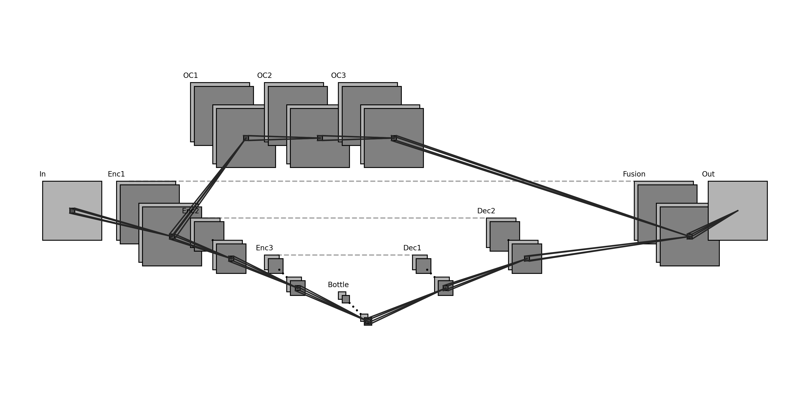

# DarkSLAM: CLEAR-IR IR-D evaluation


DarkSLAM enhances infrared images with CLEAR-IR, extracts SuperPoint features,
and runs the ORB-SLAM3 RGB-D backend using the measured depth stream. The default
pipeline runs headlessly and needs neither ROS nor Pangolin.

```text
infra1 → CLEAR-IR → SuperPoint → DarkSLAM → camera trajectory + ATE
depth ─────────────────────────────↗
```



## Setup

Use Linux, Python 3.10 or 3.11, a C++17 compiler, CMake 3.16+, OpenCV 4.4+, Eigen3,
Boost serialization, OpenSSL, and PyTorch/LibTorch. DBoW3, g2o, and Sophus sources
are included. Evaluation uses an available GPU by default, with CPU fallback.
Use `--device cpu` to force CPU execution, or set `CUDA_VISIBLE_DEVICES` to choose
a GPU. A CUDA-enabled PyTorch installation is required for GPU feature extraction.

```bash
sudo apt-get install build-essential cmake git-lfs python3-venv libopencv-dev \
    libeigen3-dev libboost-serialization-dev libssl-dev

git lfs install
git clone https://github.com/nathanshankar/DarkSLAM.git
cd DarkSLAM
git lfs pull

python3 -m venv .venv
source .venv/bin/activate
python -m pip install -r requirements.txt
python -m pip install 'torch==2.7.0' --index-url https://download.pytorch.org/whl/cu126
PYTHON=python JOBS=2 ./build.sh
```

The example uses the tested CUDA 12.6 PyTorch build. For a CPU-only installation,
replace the PyTorch index suffix `cu126` with `cpu` and use `--device cpu`.
For other CUDA versions, install the appropriate PyTorch build before building.
Use the same PyTorch installation at build time and runtime. `build.sh` discovers
LibTorch through `PYTHON` (default `python3`); it has no machine-specific paths.
Set `JOBS` to control compiler memory use. A prebuilt LibTorch can instead be
configured directly with CMake using `-DTorch_DIR=/path/to/libtorch/share/cmake/Torch`.
The executable is `build/bin/rgbd_tum_headless`.

Required inference assets:

| Path | Purpose |
| --- | --- |
| `models/clearir.h5` | Supplied CLEAR-IR checkpoint, including its serialized architecture |
| `Vocabulary/SuperPointNet.pt` | SuperPoint TorchScript feature extractor |
| `Vocabulary/superpoint_voc.dbow3` | SuperPoint vocabulary for place recognition; stored with Git LFS |

All three assets are present in this prepared workspace. When publishing these
changes, run `git lfs install` before adding the vocabulary so its large binary
is uploaded through LFS. The checkpoint and SuperPoint extractor fit in ordinary
Git files. The CLI checks that all required assets exist before processing.
See [model notes](models/README.md) for the checkpoint's relationship to the supplied
research `clearir.py`. Inference loads the H5 directly with `compile=False`.

## Get the CLEARIR datasets

Get the datasets from **[nathanshankar/CLEARIR_rosbags](https://github.com/nathanshankar/CLEARIR_rosbags)**.
The repository provides extracted, timestamped images and sensor CSVs under
`dark/` and `dim/`. Images are Git LFS objects: a normal checkout without LFS
contains pointer files that cannot be decoded.

Download one sequence to start:

```bash
mkdir -p data
GIT_LFS_SKIP_SMUDGE=1 git clone \
    https://github.com/nathanshankar/CLEARIR_rosbags.git data/CLEARIR_rosbags
git -C data/CLEARIR_rosbags lfs pull --include='dark/ros_square_1_lap/**'
```

To download every sequence, run `git -C data/CLEARIR_rosbags lfs pull` without an
include filter. Available sequence directories are:

| Lighting | Sequences |
| --- | --- |
| `dark/` | `ros_forward_backward`, `ros_square_1_lap`, `ros_square_2_lap` |
| `dim/` | `forward_backward`, `square_1lap`, `square_2lap` |

Each sequence used for evaluation should contain:

```text
sequence/
├── infra1/<timestamp_ns>.png    # left IR, uint8 grayscale, 640×480
├── depth/<timestamp_ns>.png     # measured depth, uint16, same pixel grid
├── camera_info/depth.txt       # ROS CameraInfo as YAML
└── vicon.csv                   # timestamp,x,y,z,qx,qy,qz,qw
```

Use `infra1`, which shares the depth camera's geometry. Right IR (`infra2`) needs
spatial depth registration before it can be used for IR-D. Timestamps are
associated one-to-one within 20 ms and converted from nanoseconds to seconds
without first rounding them through a floating-point representation. The CLI
reads intrinsics and distortion from the sequence's `camera_info/depth.txt`.
It uses millimetre depth by default (`--depth-factor 1000`). For a different
camera or a locally extracted dataset without CameraInfo, supply `--settings`
with a calibrated OpenCV YAML file; `configs/clearir.yaml` shows the format.
Images are kept at their native resolution and depth is never enhanced or resized.

For an existing local extraction whose `camera_info/` directory is empty, pass
the bundled CLEARIR calibration explicitly:

```bash
python3 -m darkslam.evaluate \
    --dataset data/CLEARIR_rosbags/dark/ros_square_1_lap \
    --settings configs/clearir.yaml \
    --groundtruth data/CLEARIR_rosbags/dark/ros_square_1_lap/vicon.csv \
    --output results/ird
```

Here `vicon.csv` is the chosen ground truth reference. Use the bundled settings only for the matching CLEARIR
camera; another camera requires its own calibration.

## Run IR-D evaluation

From the repository root, with the Python environment activated:

```bash
python -m darkslam.evaluate \
    --dataset data/CLEARIR_rosbags/dark/ros_square_1_lap \
    --output results/dark_sq1_clearir
```

This single command associates IR/depth frames, enhances the selected IR frames,
runs SLAM, and evaluates the camera trajectory against `vicon.csv`. TensorFlow
inference completes in a separate process before the LibTorch SLAM process starts.
Results go into the chosen output directory, which must be empty to avoid mixing runs.
During SLAM, the terminal and `slam.log` show frame count, percentage, tracking
state, elapsed time, and an ETA every ten frames. `tracking.csv` is flushed after
each frame so `tail -f results/ird/tracking.csv` shows completed frames immediately.
State `2` means tracking is OK. CPU evaluation is offline: at about 1.3 seconds
per frame, a 1,258-frame sequence takes roughly 27 minutes for SLAM, plus image
enhancement time. Actual speed depends on hardware and scene content.

Useful variants:

```bash
# Short end-to-end check
python -m darkslam.evaluate \
    --dataset data/CLEARIR_rosbags/dark/ros_square_1_lap \
    --output results/smoke --max-frames 120

# Raw IR baseline with the same depth and feature extractor
python -m darkslam.evaluate \
    --dataset data/CLEARIR_rosbags/dark/ros_square_1_lap \
    --output results/dark_sq1_raw --mode raw

# Use available GPUs and save an optional tracking video
python -m darkslam.evaluate \
    --dataset data/CLEARIR_rosbags/dark/ros_square_1_lap \
    --output results/dark_sq1_gpu --device auto --video

# Save an SE(3)-aligned estimate/ground-truth comparison (XY, XZ, YZ)
python -m darkslam.evaluate \
    --dataset data/CLEARIR_rosbags/dark/ros_square_1_lap \
    --output results/dark_sq1_plot --plot
```

Use `--prepare-only` to stop after writing enhanced images, associations, and
settings. `--stride N` evaluates every Nth associated pair. Paths for the model,
vocabulary, feature extractor, and binary can be overridden with `--model`,
`--vocabulary`, `--superpoint`, and `--binary`. Run `python -m darkslam.evaluate --help`
for all options.

`--plot` saves `trajectory.png` using the same timestamp matches, time offset,
and fixed-scale SE(3) alignment as the ATE calculation. It shows matched ground
truth and aligned estimated positions in XY, XZ, and YZ projections, with ATE
RMSE in the title. All views use equal distance scales on both axes.
It requires ground truth and cannot be combined with `--prepare-only`.
To plot a completed run without rerunning enhancement or SLAM:

```bash
python -m darkslam.plotting \
    --trajectory results/ird_gpu/trajectory.txt \
    --groundtruth data/CLEARIR_rosbags/dark/ros_square_1_lap/vicon.csv
```

This also saves `trajectory.png` beside the input trajectory. Pass `--gt-offset`,
`--gt-max-difference`, and `--gt-timestamp-unit` if they were used for evaluation.

## Outputs and evaluation

| File | Contents |
| --- | --- |
| `trajectory.txt` | Camera poses in TUM format: seconds, tx ty tz, qx qy qz qw |
| `keyframes.txt` | Keyframe camera poses in TUM format |
| `metrics.json` | Translational ATE in metres, pose counts, coverage, and elapsed time |
| `aligned_positions.txt` | Positions used in the ATE comparison after rigid alignment |
| `tracking.csv` | Per-frame tracking time and ORB-SLAM3 tracking state |
| `slam.log` / `clearir.log` | Backend and model-inference logs |
| `run.json` | Arguments, pairing statistics, preprocessing time, and checkpoint SHA-256 |
| `settings.yaml` / `associations.txt` | Exact camera settings and input pairs for this run |
| `enhanced/` | CLEAR-IR grayscale images; source depth files are referenced directly |
| `tracking.mp4` | Tracking video when `--video` is requested |
| `trajectory.png` | Ground truth vs SE(3)-aligned estimate in XY, XZ, YZ, when `--plot` is requested |

ATE uses **SE(3) alignment with scale fixed to 1**. Depth supplies metric scale;
a scale fit would hide depth/calibration errors. Ground truth and estimate are
matched one-to-one within 20 ms. The trajectory export uses the atlas map with
the most keyframes, since separately initialized maps have unrelated coordinate
origins. `tracked_fraction` reports exported poses divided by selected input
pairs; interpret ATE together with coverage and evaluated duration.

The default reference is the dataset's `vicon.csv`. `--groundtruth path.csv` or `path.txt` selects another
reference (CSV columns as above, or TUM format). `--no-groundtruth` runs tracking
without ATE. `--gt-timestamp-unit` and `--gt-offset` handle reference timebases;
the offset in seconds is added to estimated timestamps for matching.

ATE compares the positions in the supplied reference to camera positions. If
Vicon tracks the robot body or a marker away from the camera centre, transform
that reference into the camera frame with the measured rigid extrinsic before
using it for camera-accuracy claims. A single global SE(3) alignment does not
remove a moving lever arm. A short smoke run verifies execution; it is not a
full-sequence accuracy benchmark. Backend timing excludes CLEAR-IR inference;
`pipeline_seconds` includes preprocessing and SLAM.

# Research Paper

The conference poster is available at [docs/clearir-poster.pdf](docs/clearir-poster.pdf).

If you found this work useful please consider citing our paper:
```bibtex
@inproceedings{shankar2026clearir,
  title     = {{CLEAR-IR}: Clarity-Enhanced Active Reconstruction of Infrared Imagery for Low-Light Enhancement},
  author    = {Shankar, Nathan and Gonczy, Marton and Yin, Hujun and Ladosz, Pawel},
  booktitle = {Proc. IEEE/RSJ Int. Conf. Intell. Robots Syst. (IROS)},
  year      = {2026},
  note      = {arXiv:2510.04883}
}
```